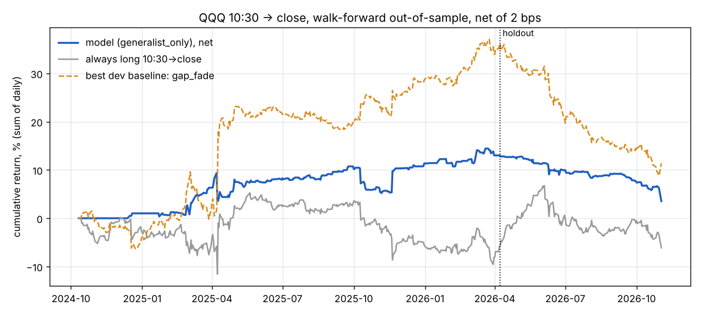
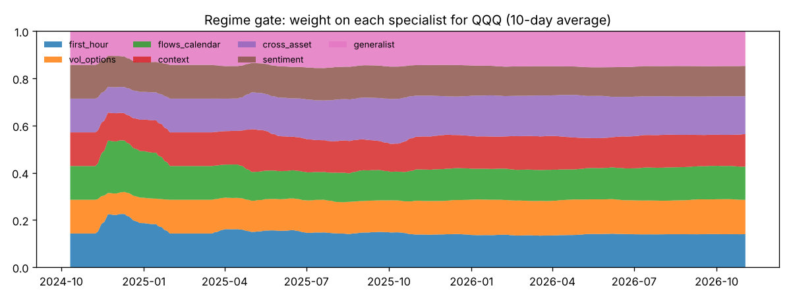

# QQQ 10:30 -> close model: walk-forward backtest

## Data

| item | value |
|---|---|
| labelled dates | 722 (2023-12-05 -> 2026-11-02) |
| QQQ labelled days | 722 |
| tickers pooled | 38 |
| rows (date x ticker) | 27436 |
| intraday sources | yahoo: 27436 |
| feature coverage by family | first_hour 100%, vol_options 100%, flows_calendar 94%, context 100%, cross_asset 98%, sentiment 30% |

## Protocol

* Expanding-window walk-forward, refit every 21 trading days, first 150 labelled days used only for training, 1-day embargo.
* Specialists are pretrained on the pooled universe; the gate and the calibration are fit only on out-of-fold forecasts from earlier folds. Every return below is out of sample.
* Development period 2024-10-11 -> 2026-04-08 (364 days) is used to choose between model variants (rule fixed in advance: highest dev Sharpe, a more complex variant must win by > 0.25). The holdout 2026-04-08 -> 2026-11-02 (145 days) was not used for any choice.
* Costs: 2 bps round trip on |position| every traded day (10:30 entry + market-on-close exit). Sensitivity to higher costs is shown below.
* Decision rule: trade only when |expected move| > cost; size grows linearly from 0.3 to 1.5 standard deviations of the signal, capped at 1x.

## Headline (chosen variant: `generalist_only`)

Holdout: Sharpe **-3.01** (90% CI -4.33 to -1.47), -6.5 bps/day net, hit rate 36.2% on 94 trades over 145 days, max drawdown -9.3%. The whole holdout Sharpe interval is **below zero**: out of sample this model lost money with statistical confidence. **Do not trade it.**

### Model variants: development period (used for selection)

|                 |   days |   trades |   hit % |   bps/day |   ann. ret % |   ann. vol % |   Sharpe | Sharpe 90% CI   |   t-stat |   max DD % |
|:----------------|-------:|---------:|--------:|----------:|-------------:|-------------:|---------:|:----------------|---------:|-----------:|
| gated           |    364 |      291 |   49.14 |      0.79 |         1.98 |        10.04 |     0.20 | [-0.72, 1.34]   |     0.24 |      -7.79 |
| equal           |    364 |      293 |   48.12 |      0.19 |         0.49 |        12.01 |     0.04 | [-0.81, 1.26]   |     0.05 |      -9.69 |
| generalist_only |    364 |      194 |   60.31 |      3.57 |         9.01 |         8.52 |     1.06 | [-0.06, 2.52]   |     1.27 |      -5.76 |
| gated_spec      |    364 |      286 |   48.95 |      0.03 |         0.08 |         6.68 |     0.01 | [-1.04, 1.20]   |     0.01 |      -7.33 |
| ridge           |    364 |        6 |   33.33 |      0.07 |         0.17 |         0.77 |     0.22 | [-1.18, 0.84]   |     0.26 |      -0.55 |

### Model variants: holdout (reported once, not used for selection)

|                 |   days |   trades |   hit % |   bps/day |   ann. ret % |   ann. vol % |   Sharpe | Sharpe 90% CI   |   t-stat |   max DD % |
|:----------------|-------:|---------:|--------:|----------:|-------------:|-------------:|---------:|:----------------|---------:|-----------:|
| gated           |    145 |       96 |   35.42 |     -1.71 |        -4.32 |         5.36 |    -0.81 | [-3.23, 1.18]   |    -0.61 |      -3.47 |
| equal           |    145 |       92 |   36.96 |     -2.31 |        -5.82 |         5.49 |    -1.06 | [-3.48, 1.00]   |    -0.80 |      -3.91 |
| generalist_only |    145 |       94 |   36.17 |     -6.53 |       -16.47 |         5.47 |    -3.01 | [-4.33, -1.47]  |    -2.28 |      -9.30 |
| gated_spec      |    145 |      110 |   40.91 |     -3.35 |        -8.44 |         6.07 |    -1.39 | [-3.50, 0.10]   |    -1.05 |      -5.77 |
| ridge           |    145 |        2 |    0.00 |     -0.57 |        -1.44 |         0.82 |    -1.76 | [-2.50, 0.00]   |    -1.33 |      -0.83 |

### Baselines: holdout

|                            |   days |   trades |   hit % |   bps/day |   ann. ret % |   ann. vol % |   Sharpe | Sharpe 90% CI   |   t-stat |   max DD % |
|:---------------------------|-------:|---------:|--------:|----------:|-------------:|-------------:|---------:|:----------------|---------:|-----------:|
| always_long                |    145 |      145 |   53.10 |     -0.19 |        -0.47 |        11.53 |    -0.04 | [-2.12, 2.54]   |    -0.03 |     -12.88 |
| always_short               |    145 |      145 |   44.83 |     -3.81 |        -9.61 |        11.53 |    -0.83 | [-3.63, 1.27]   |    -0.63 |     -14.08 |
| morning_momentum           |    145 |      145 |   52.41 |      6.16 |        15.53 |        11.46 |     1.36 | [-0.15, 3.27]   |     1.03 |      -5.57 |
| morning_reversal           |    145 |      145 |   45.52 |    -10.16 |       -25.61 |        11.46 |    -2.24 | [-4.15, -0.88]  |    -1.70 |     -18.43 |
| first_hour_momentum        |    145 |      145 |   48.97 |      0.90 |         2.26 |        11.52 |     0.20 | [-1.90, 2.63]   |     0.15 |      -5.72 |
| gap_fade                   |    145 |      145 |   40.69 |    -17.04 |       -42.95 |        11.28 |    -3.81 | [-5.45, -2.77]  |    -2.89 |     -27.17 |
| prev_day_intraday_momentum |    145 |      145 |   51.03 |      2.93 |         7.38 |        11.50 |     0.64 | [-2.00, 2.06]   |     0.49 |      -7.89 |
| trend_20d                  |    145 |      145 |   55.17 |      2.72 |         6.86 |        11.50 |     0.60 | [-1.86, 3.01]   |     0.45 |     -10.48 |

### Baselines: development period

|                            |   days |   trades |   hit % |   bps/day |   ann. ret % |   ann. vol % |   Sharpe | Sharpe 90% CI   |   t-stat |   max DD % |
|:---------------------------|-------:|---------:|--------:|----------:|-------------:|-------------:|---------:|:----------------|---------:|-----------:|
| always_long                |    364 |      364 |   54.67 |     -1.61 |        -4.06 |        15.72 |    -0.26 | [-1.47, 0.62]   |    -0.31 |     -14.83 |
| always_short               |    364 |      364 |   43.41 |     -2.39 |        -6.02 |        15.72 |    -0.38 | [-1.28, 0.69]   |    -0.46 |     -20.07 |
| morning_momentum           |    364 |      364 |   47.25 |     -7.00 |       -17.63 |        15.70 |    -1.12 | [-2.60, -0.03]  |    -1.35 |     -28.33 |
| morning_reversal           |    364 |      364 |   50.82 |      3.00 |         7.55 |        15.70 |     0.48 | [-0.59, 1.83]   |     0.58 |     -11.61 |
| first_hour_momentum        |    364 |      364 |   53.02 |     -0.51 |        -1.30 |        15.72 |    -0.08 | [-1.39, 0.87]   |    -0.10 |     -17.86 |
| gap_fade                   |    364 |      364 |   50.82 |      9.92 |        24.99 |        15.61 |     1.60 | [0.13, 2.64]    |     1.92 |      -9.79 |
| prev_day_intraday_momentum |    364 |      358 |   44.97 |    -13.08 |       -32.97 |        15.62 |    -2.11 | [-3.20, -0.95]  |    -2.54 |     -53.13 |
| trend_20d                  |    364 |      364 |   51.10 |     -4.35 |       -10.97 |        15.72 |    -0.70 | [-1.49, 0.32]   |    -0.84 |     -20.94 |

### Chosen variant over the whole evaluated period

|                 |   days |   trades |   hit % |   bps/day |   ann. ret % |   ann. vol % |   Sharpe | Sharpe 90% CI   |   t-stat |   max DD % |
|:----------------|-------:|---------:|--------:|----------:|-------------:|-------------:|---------:|:----------------|---------:|-----------:|
| generalist_only |    509 |      288 |   52.43 |      0.69 |         1.75 |         7.80 |     0.22 | [-0.65, 1.49]   |     0.32 |     -10.89 |

## Charts

## Cost sensitivity (chosen variant)

| cost bps | dev Sharpe | dev bps/day | holdout Sharpe | holdout bps/day |
|---|---|---|---|---|
| 0 | 1.23 | 4.17 | -2.77 | -5.99 |
| 1 | 1.14 | 3.87 | -2.89 | -6.26 |
| 2 | 1.06 | 3.57 | -3.01 | -6.53 |
| 5 | 0.79 | 2.68 | -3.36 | -7.36 |
| 10 | 0.35 | 1.19 | -3.94 | -8.73 |

## Forecast quality (rank IC, out of sample)

IC = Spearman correlation between forecast and realised vol-normalised 10:30->close move. 'pooled' covers every ticker in the universe: a signal that only works on QQQ and nowhere else is a red flag.

| forecast | IC on QQQ | IC pooled |
|---|---|---|
| first_hour | 0.026 | 0.015 |
| vol_options | 0.059 | 0.043 |
| flows_calendar | -0.003 | 0.011 |
| context | -0.015 | -0.016 |
| cross_asset | 0.090 | 0.076 |
| sentiment | -0.055 | -0.057 |
| generalist | 0.076 | 0.069 |
| gated | 0.021 | 0.016 |
| equal | 0.015 | 0.012 |
| generalist_only | 0.076 | 0.069 |
| gated_spec | -0.008 | 0.015 |
| ridge | 0.013 | 0.040 |

Per-ticker IC of the chosen variant: positive on 38 of 38 tickers, median 0.076.

## Stability over time (chosen variant, QQQ)

A real edge should be positive in most quarters. A sign flip between periods means the model learned a pattern that the market stopped paying for.

| quarter | days | IC | net bps/day | Sharpe |
|---|---|---|---|---|
| 2024Q4 | 54 | +0.238 | +1.87 | +3.08 |
| 2025Q1 | 60 | +0.251 | +8.85 | +3.12 |
| 2025Q2 | 62 | +0.135 | +2.67 | +0.49 |
| 2025Q3 | 63 | +0.296 | +4.38 | +3.72 |
| 2025Q4 | 62 | -0.014 | +1.00 | +0.22 |
| 2026Q1 | 59 | +0.144 | +2.87 | +1.04 |
| 2026Q2 | 62 | -0.124 | -5.00 | -2.30 |
| 2026Q3 | 64 | -0.170 | -3.51 | -3.07 |
| 2026Q4 | 23 | -0.353 | -18.12 | -4.96 |

## By regime (chosen variant, all evaluated days, net)

**VIX tercile**

| bucket | days | bps/day | Sharpe | hit % |
|---|---|---|---|---|
| high VIX | 170 | 3.41 | 0.71 | 54.5 |
| mid VIX | 169 | -1.63 | -0.78 | 45.9 |
| low VIX | 170 | 0.29 | 0.24 | 57.3 |

**trend**

| bucket | days | bps/day | Sharpe | hit % |
|---|---|---|---|---|
| uptrend | 456 | 0.85 | 0.35 | 50.4 |
| downtrend | 53 | -0.68 | -0.11 | 64.3 |

**morning move**

| bucket | days | bps/day | Sharpe | hit % |
|---|---|---|---|---|
| |move| < 0.5 sd | 250 | 1.49 | 0.62 | 54.2 |
| > 1 sd | 108 | -0.63 | -0.13 | 48.4 |
| 0.5-1 sd | 151 | 0.32 | 0.14 | 52.4 |

## Calibration of P(up)

|   p_up |   p_up_mean |   realised_up |       n |
|-------:|------------:|--------------:|--------:|
|      0 |       0.504 |         0.490 | 102.000 |
|      1 |       0.527 |         0.539 | 102.000 |
|      2 |       0.544 |         0.614 | 101.000 |
|      3 |       0.561 |         0.598 | 102.000 |
|      4 |       0.588 |         0.510 | 102.000 |

## Average gate weights (QQQ)

|                |   weight |
|:---------------|---------:|
| first_hour     |    0.148 |
| vol_options    |    0.138 |
| flows_calendar |    0.139 |
| context        |    0.138 |
| cross_asset    |    0.161 |
| sentiment      |    0.131 |
| generalist     |    0.145 |

## Honest caveats

* One decision per day: a few hundred days give a Sharpe standard error of roughly 0.7-1.0. Treat every number as noisy.
* Yahoo's free 60-minute history is ~730 days. `fm backfill-av` (free Alpha Vantage key) can extend QQQ back years; the store also keeps every day you download, so the sample grows if you run `fm update` daily.
* Options positioning (GEX) and live news/LLM sentiment have no free history, so they are shown live as context and archived daily, but are not part of the traded model until they can be validated.
* Fills assume the 10:30 last trade and the official close. Real slippage at 10:30 and MOC imbalance risk are covered only by the cost assumption.
